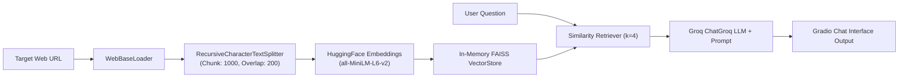

# 🌐 Web-RAG Assistant — LangChain, FAISS & Groq

[](https://www.python.org/)
[](https://www.langchain.com/)
[](https://github.com/facebookresearch/faiss)
[](https://huggingface.co/)
[](https://groq.com/)
[](LICENSE)

A dynamic **Retrieval-Augmented Generation (RAG)** application capable of scraping, indexing, and answering detailed questions about live web pages and documents in real time. Built with **LangChain**, **FAISS** vector store, **Hugging Face** embeddings, and **Groq Cloud LLM** with an intuitive **Gradio** web interface.

---

## 📸 Application Preview

<p align="center">
  
</p>

---

## 🛠️ Retrieval Architecture



---

## 🌟 Key Features

- 🌐 **Instant URL Ingestion:** Scrapes web pages on the fly using `WebBaseLoader`.
- 🧩 **Semantic Chunking:** Splits lengthy web documents with `RecursiveCharacterTextSplitter` preserving semantic paragraph boundaries.
- 📐 **Dense Vector Search:** Embeds text chunks via `sentence-transformers/all-MiniLM-L6-v2` into a fast FAISS vector index.
- ⚡ **Groq Accelerated Inference:** Queries `ChatGroq` for rapid, grounded contextual answers with zero hallucination.

---

## 📂 Project Structure

```plaintext
GENAI_day2_project/
├── code1.py          # Complete LangChain RAG pipeline & Gradio UI
├── .gitignore        # Clean repository filter
└── README.md         # Documentation & demo screenshot
```

---

## ⚡ Quickstart

```bash
# Clone the repository
git clone https://github.com/SLAYWITHME2005/GENAI_day2_project.git
cd GENAI_day2_project

# Install dependencies
pip install langchain langchain-community langchain-groq langchain-huggingface faiss-cpu gradio sentence-transformers beautifulsoup4 python-dotenv

# Set your Groq API key
export GROQ_API_KEY="your_api_key_here"  # On Windows PowerShell: $env:GROQ_API_KEY="your_api_key_here"

# Launch the application
python code1.py
```

---

## 👩‍💻 Author
- **Gayathri Rajeev** ([@SLAYWITHME2005](https://github.com/SLAYWITHME2005))
